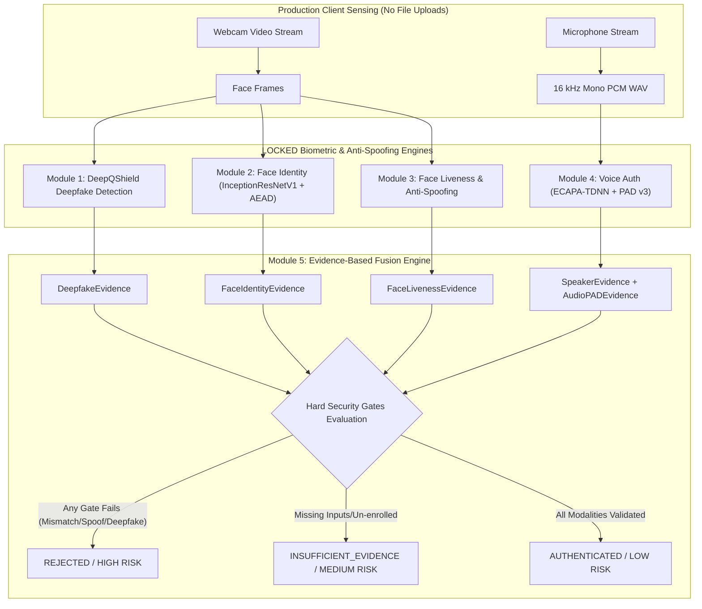

# Module 5 — Multimodal Fusion & Unified Authentication Implementation Guide

## 1. Architecture & System Overview

Module 5 serves as the unified multimodal orchestrator and evidence-based decision engine for DeepGuard. It connects the four previously locked modules (Module 1 DeepQShield, Module 2 Face Identity, Module 3 Face Liveness, and Module 4 Voice Authentication & Audio PAD) into a single end-to-end security pipeline without modifying their internal locked code.

---

## 2. Consumed Module Interfaces

Module 5 interfaces cleanly with existing locked engines via Python services and adapters:

1. **Module 1 — DeepQShield Deepfake Detector:**
   - Interface: `VideoDeepfakeAnalyzer.analyze_frame_sequence(frames_bgr: List[np.ndarray])`
   - Output: `DeepfakeEvidence` (`fake_probability`, `classification`, `confidence`).
2. **Module 2 — Face Identity Engine:**
   - Interface: `FaceService.verify_face(user_id: str, image_base64: str)`
   - Output: `FaceIdentityEvidence` (`matched`, `similarity_score`, `threshold`).
3. **Module 3 — Face Liveness & Anti-Spoofing:**
   - Interface: `LivenessService.evaluate_passive_liveness(frames_base64: List[str])`
   - Output: `FaceLivenessEvidence` (`liveness`, `score`, `threshold`, `attack_type`).
4. **Module 4 — Voice Authentication & Audio PAD:**
   - Interface: `VoiceService.verify_voice(user_id: str, audio_base64: str, session_id: str)`
   - Output: `SpeakerEvidence` (`speaker_verdict`, `voice_similarity`), `AudioPADEvidence` (`liveness_verdict`, `liveness_score`, `attack_type`).

---

## 3. Evidence-Based Decision Engine & Hard Security Gates

Module 5 explicitly rejects naive weighted averages. A high score in one modality **cannot** compensate for a confirmed spoof or mismatch in another.

### Hard Security Gates Enforced
- **Gate 1 (Face Identity):** `face_identity.status == "MISMATCH"` $\rightarrow$ `REJECTED`
- **Gate 2 (Face Liveness):** `face_liveness.status == "SPOOF"` $\rightarrow$ `REJECTED`
- **Gate 3 (Deepfake):** `deepfake_detection.status in ["DEEPFAKE", "HIGH_RISK"]` $\rightarrow$ `REJECTED`
- **Gate 4 (Speaker Identity):** `speaker_identity.status == "MISMATCH"` $\rightarrow$ `REJECTED`
- **Gate 5 (Audio PAD):** `audio_pad.status == "SPOOF"` $\rightarrow$ `REJECTED`
- **Gate 6 (Quality / Detection):** `MULTIPLE_FACES_DETECTED` $\rightarrow$ `REJECTED`
- **Gate 7 (Session Challenge Security):** Expired or invalid session challenge token $\rightarrow$ `REJECTED`

---

## 4. Risk Classification

- **`HIGH` Risk:** Any hard security gate failure (face/speaker mismatch, face spoof, audio spoof, deepfake detected, multiple faces, expired session token).
- **`MEDIUM` Risk:** Missing modality input, un-enrolled user, or poor frame/audio quality.
- **`LOW` Risk:** All required modalities validated with zero failed checks or attack indicators.

---

## 5. Security & Privacy Controls

1. **Production Input:** Webcam video stream and microphone recording ONLY. No production file uploads.
2. **Audio Transport:** 16 kHz mono PCM WAV format.
3. **Session Binding:** Reuses Module 4's 300-second TTL single-use cryptographic session challenge.
4. **Biometric Privacy:** Raw audio bytes processed in-memory and discarded. Raw 512-d and 192-d embeddings are never returned in API responses.
5. **Template Protection:** AES-256-GCM AEAD encryption.

---

## 6. Known Limitations

- **Phrase Verification:** Confirmed `phrase_match = "UNVALIDATED"`. Text-dependent / phrase verification is not validated in Module 5.
